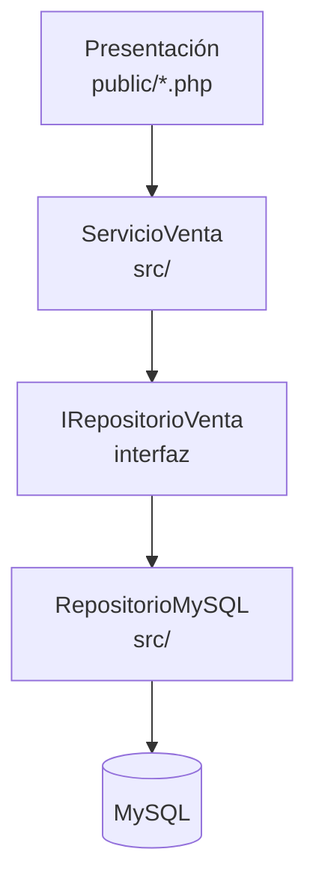
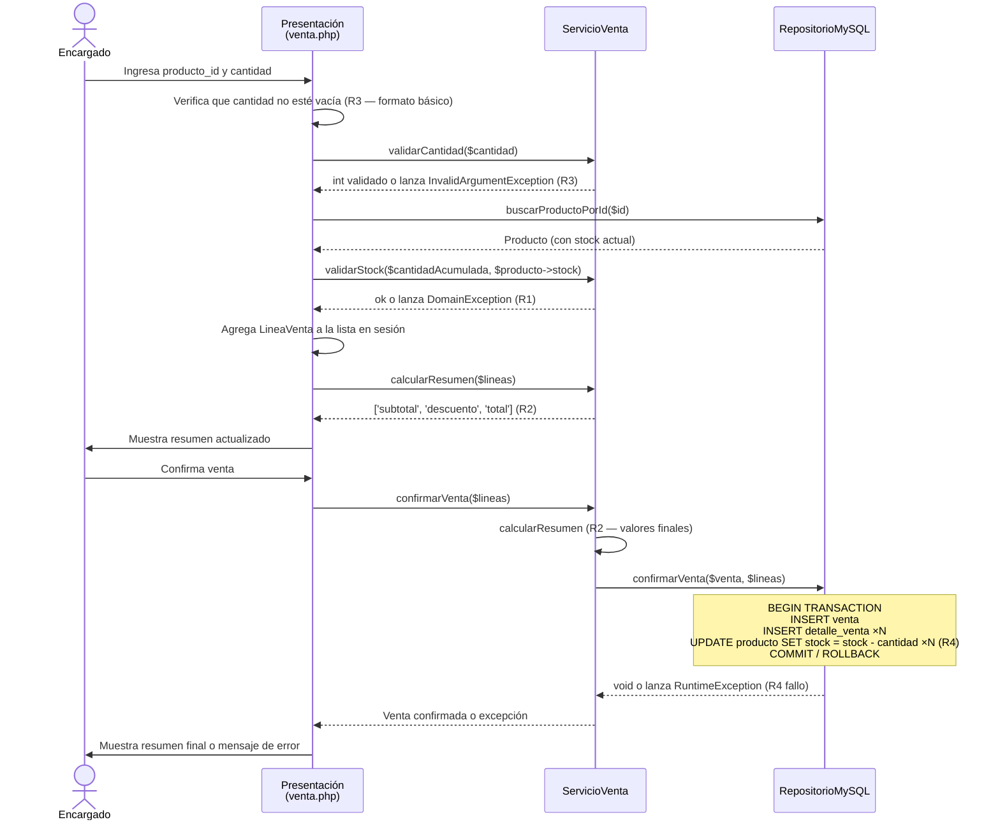

# Design Document — Registro de Ventas de la Bodega «Doña Rosa»

## Overview

El sistema permite al encargado de la bodega registrar productos (nombre, precio, stock) y registrar ventas seleccionando productos y cantidades. Al confirmar una venta, el sistema valida cantidades, verifica stock, aplica el descuento del 5 % cuando corresponde y descuenta el stock de forma atómica.

El objetivo de diseño principal es mantener la lógica de negocio (R1–R4) completamente aislada en `ServicioVenta`, de modo que sea verificable con PHPUnit sin base de datos real. La persistencia es responsabilidad de `RepositorioMySQL`, que implementa una interfaz (`IRepositorioVenta`) para permitir la sustitución por un doble de prueba.

---

## Architecture

El sistema sigue una **arquitectura en tres capas** sin framework:

```
┌─────────────────────────────────────────────────────┐
│  Capa de Presentación                               │
│  Archivos .php en public/ con HTML + PHP mezclado   │
│  Responsabilidad: entrada/salida HTTP, mensajes UI  │
│  Valida: R3 (formato básico de entrada)             │
├─────────────────────────────────────────────────────┤
│  Capa de Lógica de Negocio                          │
│  src/ServicioVenta.php                              │
│  Responsabilidad: reglas de negocio puras           │
│  Valida: R1 (stock), R2 (descuento), R3 (cantidad) │
├─────────────────────────────────────────────────────┤
│  Capa de Acceso a Datos                             │
│  src/RepositorioMySQL.php (impl. de IRepositorio)   │
│  Responsabilidad: SQL con PDO + transacciones       │
│  Ejecuta: R4 (actualización atómica de stock)       │
└─────────────────────────────────────────────────────┘
```

**Principio de dependencias:** la capa de presentación llama a `ServicioVenta`; `ServicioVenta` llama a `IRepositorioVenta` (interfaz). `RepositorioMySQL` implementa esa interfaz. Ninguna capa superior conoce los detalles de la inferior.



---

## Components and Interfaces

### `IRepositorioVenta` (interfaz)

```php
interface IRepositorioVenta
{
    /** @return Producto[] */
    public function listarProductos(): array;

    public function buscarProductoPorId(int $id): ?Producto;

    public function guardarProducto(Producto $producto): void;

    public function confirmarVenta(Venta $venta, array $lineas): void;
    // Ejecuta la transacción completa: INSERT venta, INSERT detalles, UPDATE stock (R4)
}
```

### `ServicioVenta`

Clase final sin dependencias de framework ni de base de datos. Recibe `IRepositorioVenta` por constructor (inyección de dependencias), lo que permite sustituirlo por un stub/mock en pruebas.

```php
final class ServicioVenta
{
    public function __construct(private IRepositorioVenta $repo) {}

    /** Valida R3. Lanza InvalidArgumentException si la cantidad no es entero > 0. */
    public function validarCantidad(mixed $cantidad): int { ... }

    /**
     * Valida R1 para una línea nueva o acumulada.
     * Lanza DomainException('Stock insuficiente: disponible N unidades') si
     * $cantidadAcumulada > $stockDisponible.
     */
    public function validarStock(int $cantidadAcumulada, int $stockDisponible): void { ... }

    /**
     * Calcula descuento y total (R2).
     * Devuelve ['subtotal' => float, 'descuento' => float, 'total' => float].
     */
    public function calcularResumen(array $lineas): array { ... }

    /**
     * Arma y confirma la venta completa.
     * Delega la persistencia atómica a $this->repo->confirmarVenta() (R4).
     */
    public function confirmarVenta(array $lineas): Venta { ... }
}
```

### `RepositorioMySQL`

Implementa `IRepositorioVenta` usando PDO con sentencias preparadas. Toda la actualización de stock ocurre dentro de una transacción MySQL (BEGIN / COMMIT / ROLLBACK) para garantizar R4.

### Páginas de presentación (`public/`)

| Archivo            | Propósito                                    |
|--------------------|----------------------------------------------|
| `index.php`        | Listado de productos y acceso al registro    |
| `producto_nuevo.php` | Formulario de nuevo producto + manejo POST |
| `venta.php`        | Interfaz de venta en curso (agregar líneas)  |
| `venta_confirmar.php` | Confirmación y resumen final              |

---

## Data Models

### Entidades PHP

```php
final class Producto
{
    public function __construct(
        public readonly ?int   $id,
        public readonly string $nombre,
        public readonly float  $precio,   // máximo 2 decimales, > 0
        public readonly int    $stock,    // entero ≥ 0
    ) {}
}

final class LineaVenta
{
    public function __construct(
        public readonly Producto $producto,
        public readonly int      $cantidad,       // entero > 0 (ya validado)
        public readonly float    $precioUnitario, // capturado en el momento de la venta
    ) {}
}

final class Venta
{
    public function __construct(
        public readonly ?int   $id,
        public readonly float  $subtotal,
        public readonly float  $descuento,
        public readonly float  $total,
        public readonly string $createdAt,
    ) {}
}
```

### Esquema MySQL

```sql
CREATE TABLE producto (
    id      INT UNSIGNED AUTO_INCREMENT PRIMARY KEY,
    nombre  VARCHAR(100)   NOT NULL UNIQUE,
    precio  DECIMAL(10, 2) NOT NULL CHECK (precio > 0),
    stock   INT UNSIGNED   NOT NULL DEFAULT 0
) ENGINE=InnoDB DEFAULT CHARSET=utf8mb4;

CREATE TABLE venta (
    id         INT UNSIGNED AUTO_INCREMENT PRIMARY KEY,
    subtotal   DECIMAL(10, 2) NOT NULL,
    descuento  DECIMAL(10, 2) NOT NULL DEFAULT 0.00,
    total      DECIMAL(10, 2) NOT NULL,
    created_at DATETIME       NOT NULL DEFAULT CURRENT_TIMESTAMP
) ENGINE=InnoDB DEFAULT CHARSET=utf8mb4;

CREATE TABLE detalle_venta (
    id               INT UNSIGNED AUTO_INCREMENT PRIMARY KEY,
    venta_id         INT UNSIGNED   NOT NULL,
    producto_id      INT UNSIGNED   NOT NULL,
    cantidad         INT UNSIGNED   NOT NULL CHECK (cantidad > 0),
    precio_unitario  DECIMAL(10, 2) NOT NULL,
    FOREIGN KEY (venta_id)    REFERENCES venta(id),
    FOREIGN KEY (producto_id) REFERENCES producto(id)
) ENGINE=InnoDB DEFAULT CHARSET=utf8mb4;
```

---

## Sequence Diagram — Registrar Venta



---

## Correctness Properties

*Una propiedad es una característica o comportamiento que debe cumplirse en todas las ejecuciones válidas del sistema — esencialmente, una declaración formal sobre lo que el sistema debe hacer. Las propiedades sirven de puente entre las especificaciones legibles por humanos y las garantías de corrección verificables automáticamente.*

---

### Property 1: El subtotal siempre es la suma exacta de precio × cantidad

*Para cualquier* lista de `LineaVenta` (posiblemente con productos repetidos cuyas cantidades han sido acumuladas), el subtotal calculado por `ServicioVenta::calcularResumen()` debe ser exactamente la suma de `precioUnitario × cantidad` de cada línea, redondeado a 2 decimales.

**Validates: Requirements 2.1, 2.3, 2.5, 5.3**

---

### Property 2: La validación de cantidad rechaza todo valor que no sea entero positivo y acepta todo entero positivo

*Para cualquier* valor de entrada que no sea un entero mayor que cero (cero, negativo, decimal, cadena no numérica, vacío), `ServicioVenta::validarCantidad()` debe lanzar `InvalidArgumentException`. *Para cualquier* entero mayor que cero, debe devolver ese entero sin error.

**Validates: Requirements 3.1, 3.2**

---

### Property 3: La validación de stock rechaza la cantidad acumulada que supera el disponible y acepta la que no lo supera

*Para cualquier* par `(cantidadAcumulada, stockDisponible)`, `ServicioVenta::validarStock()` debe lanzar `DomainException` si `cantidadAcumulada > stockDisponible`, y debe completar sin error si `cantidadAcumulada ≤ stockDisponible` (incluyendo el caso exacto `cantidadAcumulada == stockDisponible`).

**Validates: Requirements 4.1, 4.2, 4.3**

---

### Property 4: El cálculo de descuento y total es siempre consistente con la regla R2

*Para cualquier* subtotal `s ≥ 0`:
- Si `s > 100,00`: el descuento devuelto es `round(s × 0.05, 2)` y el total es `round(s − descuento, 2)`.
- Si `s ≤ 100,00`: el descuento devuelto es `0.00` y el total es igual al subtotal.

**Validates: Requirements 5.1, 5.2**

---

## Error Handling

| Situación | Excepción / Respuesta | Capa responsable |
|---|---|---|
| Cantidad no entera > 0 | `InvalidArgumentException` con mensaje R3 | `ServicioVenta` |
| Stock insuficiente | `DomainException('Stock insuficiente: disponible N unidades')` | `ServicioVenta` |
| Fallo en transacción de BD | `RuntimeException('Error al confirmar la venta. Intente nuevamente')` | `RepositorioMySQL` → relanzada |
| Nombre de producto duplicado | `DomainException` o manejo del UNIQUE constraint de MySQL | `RepositorioMySQL` |
| Precio o stock inválidos en formulario | Validación en presentación, no llega a `ServicioVenta` | Presentación |

La capa de presentación captura todas las excepciones provenientes de `ServicioVenta` y `RepositorioMySQL`, las traduce a mensajes de usuario y nunca expone trazas de pila en producción.

---

## Testing Strategy

### Enfoque dual: pruebas unitarias + pruebas basadas en propiedades

**Pruebas unitarias (`tests/ServicioVentaTest.php`)**

Cubren ejemplos concretos, casos límite y errores:

- Subtotal correcto con una y varias líneas (incluyendo producto repetido acumulado).
- Cantidad exactamente igual al stock → aceptada.
- Cantidad igual a 1 → aceptada.
- Subtotal exactamente S/ 100,00 → descuento cero.
- Subtotal S/ 100,01 → descuento 5 %.
- Fallo en `confirmarVenta` cuando el repositorio lanza excepción.

Todas las pruebas unitarias usan un **stub o mock** de `IRepositorioVenta`; no requieren MySQL.

**Pruebas basadas en propiedades**

La biblioteca elegida es [**eris/eris**](https://github.com/giorgiosironi/eris) (compatible con PHPUnit y PHP 8).

Cada propiedad del diseño se implementa como un único test de propiedad con mínimo 100 iteraciones:

| Test | Propiedad validada | Generadores |
|---|---|---|
| `subtotalEsSumaExacta` | Property 1 | Listas aleatorias de `(precio: float > 0, cantidad: int > 0)` |
| `cantidadInvalidaEsRechazada` | Property 2 (rama inválida) | Enteros ≤ 0, decimales, strings no numéricos, vacío |
| `cantidadValidaEsAceptada` | Property 2 (rama válida) | Enteros positivos aleatorios |
| `stockInsuficienteEsRechazado` | Property 3 (rama rechazo) | Pares `(cantidad, stock)` con `cantidad > stock` |
| `stockSuficienteEsAceptado` | Property 3 (rama aceptación) | Pares `(cantidad, stock)` con `cantidad ≤ stock` |
| `descuentoConSubtotalAlto` | Property 4 (rama > 100) | Floats en `(100.01, 999999.99)` |
| `sinDescuentoConSubtotalBajo` | Property 4 (rama ≤ 100) | Floats en `(0.01, 100.00)` |

Etiqueta de referencia para cada test:
```
// Feature: bodega-ventas, Property N: <texto de la propiedad>
```

**Pruebas de integración**

Para los criterios de aceptación marcados como INTEGRATION (1.1, 1.2, 1.6, 4.4, 4.5, 4.6), se usarán pruebas de integración con una base de datos de prueba separada (base de datos `bodega_test`), ejecutadas con PHPUnit. Estas no requieren eris/eris.
